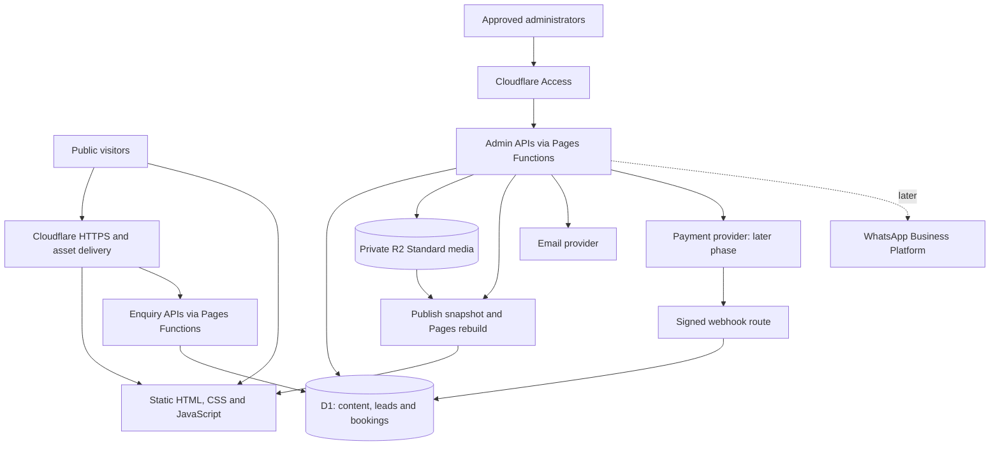

# Architecture proposal: Makeover and Academy

Status: architecture established 7 November 2026; local MVP implemented 8 November 2026. Production deployment and capacity acceptance remain pending. See docs/QA.md for measured results and docs/deployment/SETUP.md for configuration gaps.

## Confirmed requirements

- Physical parlour and academy in Janakpuri, West Delhi, India; INR pricing.
- Public Home, About, Academy, Makeup Services with pricing, Portfolio, and Contact pages.
- Mobile-responsive, search-engine-readable content and enquiry collection.
- Admin manages media, services/prices, offers, and upcoming academy batches. Academy contact details can remain static initially.
- Customers request dates; admin confirms availability before payment.
- Design for 100 concurrent browsing visitors; validate actual capacity before launch.
- Launch budget: pay only for domain registration/renewal. This supersedes the earlier INR 1,000/month hosting allowance. Use free plans; consider paid upgrades only when the owner later chooses them.
- Online payments are a staged addition; automated WhatsApp updates follow later.

## Recommended stack

Implementation must follow the SOLID and practical modular-design rules in [Engineering standards](docs/architecture/ENGINEERING_STANDARDS.md). Use a modular monolith with explicit domain/application/adapter boundaries and small injected dependencies.

Use Astro static output with TypeScript, small framework-free admin scripts, Cloudflare Pages for public files, narrowly routed Pages Functions on Workers Free for APIs, D1 Free for relational data, and private R2 Standard for admin-uploaded photos, as requested by the owner. During publishing, copy approved optimized photos into Pages static output: visitors never read from R2. Keep one Pages application with functions importing backend modules; no Astro SSR adapter is required for public rendering. Apply the conservative R2 limits in docs/deployment/BUDGET.md, but do not claim a provider-enforced zero-spend cap.

Astro suits a content-led business site: complete HTML for search engines and little browser JavaScript. Public content is generated during a build. Admin publishing triggers a new build, accepting a short publication delay to keep browsing off the dynamic CPU/request budget. A framework alone does not guarantee rankings.

## Rendering and content freshness

| Routes/content | Delivery | Update behavior |
| --- | --- | --- |
| About, Contact, policy pages | Prerendered HTML | Code/content deployment |
| Home, Academy, Services, service details, Portfolio | Prerendered HTML on Pages | Admin Publish triggers rebuild; target a few minutes, subject to queue/build limits |
| Admin UI | Static shell behind Access | Private data fetched only through authenticated APIs |
| Leads, admin mutations, later checkout/webhooks | Dynamic APIs, private/no-store | Read authoritative database state |
| Published photos | Copied from private R2 into Pages static output | Versioned local URLs updated by successful publish |

Keep editorial content in D1; static business information in version-controlled content. Draft saving does not rebuild. Publish creates an immutable allowlisted content snapshot (no leads, credentials or internal notes), then invokes a server-held Pages deploy hook. The build retrieves a snapshot using a scoped build credential and creates HTML. Track requested revision separately from the last successfully deployed revision; show pending/failed status and retry. Coalesce repeated publishes, enforce a build budget below 500/month, and preserve the last successful site on failure. Keep hook/build credentials out of browser code. Indexable content is present in initial HTML.

Configure Functions routing for API endpoints only; ordinary HTML/assets must bypass function execution. Private APIs and previews are no-store. Offers display explicit validity dates, and quotes always check current rules server-side. Schedule/batch start and end publications within the build budget; client-side hiding of expired banners is supplementary, not the source of truth. If a boundary build fails, old HTML can remain, so never promise instant expiry/removal and keep dates visible. Urgent media withdrawals need provider invalidation/removal and republishing, not just hiding a database record.

## Public experience

- Home: original brand imagery, two clear paths (services / academy), selected work, genuine testimonials, location and calls to action.
- About: artist/team story, verified experience, studio and training facilities.
- Academy: course summaries, duration and format, curriculum highlights, trainer information, next batch, student work, FAQs, counselling enquiry. Keep contact details static. Do not imply accreditation, placement guarantees, or courses not actually offered.
- Makeup Services: categories, individual detail URLs, inclusions/exclusions, fixed or clearly labelled starting prices, travel/trial information, and request-a-date action.
- Portfolio: bridal, party and academy/student categories, accessible gallery and optimized images; paginate large galleries.
- Contact: real address, opening hours, phone, directions link and enquiry form; map embed loads on interaction.
- Footer: privacy, terms, and cancellation/refund policies before payment launch.

Enquiry form: name, mobile, service/course interest, optional email, optional preferred date and message. Collect only the fields useful for follow-up. Explain contact use; record separate optional consent for promotions. A booking enquiry is not consent to broadcast discounts.

Use an inline enquiry form and a small dismissible offer banner first. A user-triggered enquiry dialog is acceptable; avoid immediate full-screen overlays or compulsory visitor login. Dialogs need keyboard support, focus handling, accessible labels and a visible close button. Remember dismissal and avoid repeated prompts.

## Admin scope

1. Lead inbox: source, interest, date received, status (new/contacted/qualified/closed), notes and follow-up date; safe CSV export if needed.
2. Media: upload, preview, captions/alt text, category, display order, draft/publish and archive; record permission to publish client/student photos.
3. Services: title, slug, description, category, inclusions, price type, INR price, active state, SEO metadata and revision history.
4. Offers: title, eligible services, discount rules, start/end times, active state and terms. Stage one supports display offers; checkout enforcement follows with payments.
5. Academy: next batch dates, course label, schedule text, enquiry-open/closed state; static course copy and contacts initially.
6. Booking requests: desired date, service, notes, admin availability decision, quote and status. Payment/reconciliation screens arrive with the gateway.

Use Cloudflare Access for a small allowlist of staff identities. Protect both `/admin/*` and `/api/admin/*`; validate Access JWT signature, issuer, audience and expiry in backend routes and map identities to permissions. Reject bypasses through preview/worker hostnames. No customer accounts initially.

## Booking and payment design

Initial workflow: enquiry received -> admin contacts customer -> availability and scope agreed -> quotation issued. Do not imply a submitted form reserves a date.

Payment phase: approved quote -> time-limited capacity hold -> payment pending -> verified captured payment -> confirmed. Also support expired, declined, cancelled, refund pending and refunded states; retain booking status separately from payment status.

- Admin selects the artist/resource and service interval including setup/travel buffers. Exact artist count, durations and holding policy remain business decisions.
- Use database-enforced reservations (for example unique artist/time blocks, inserted atomically in a D1 batch), not a read-then-write availability check. Competing approvals must not reserve the same capacity.
- Snapshot the agreed description, price, discount, deposit and currency on a versioned quote; store amounts as integer paise. Later catalogue changes do not silently change issued quotes.
- Create gateway orders on the server from the approved quote. Use opaque, expiring customer links; never expose sequential booking IDs as authorization.
- Verify webhook signatures over the original request bytes. Check order, amount, currency and captured status; deduplicate provider event/payment IDs and make transitions idempotent. Browser redirects alone never confirm a booking.
- Reconcile missed/out-of-order webhooks with the provider. Late payment after hold expiry goes to manual review/refund handling, never silently overbooks. Display payment-pending until verification succeeds.
- Persist notification jobs in the database alongside business changes, then retry delivery. Email failure must not lose a lead or roll back a valid payment.
- Use hosted gateway checkout; do not store card details. Razorpay is a candidate for India, subject to onboarding and the final merchant quote.

## Capacity and validation

100 concurrent visitors is a workload target, not a monthly traffic estimate. At one page navigation per 15 seconds, 100 active visitors generate about 6.7 HTML requests/second, plus assets. Sustained all day that is about 576,000 HTML requests/day, above the Workers free dynamic allowance if all hit the Worker. A 30-minute peak is about 12,000 HTML requests. These are examples, not traffic forecasts.

In the revised design HTML and published photos are static Pages requests and do not consume Functions or R2 operation quotas. Enquiry/admin APIs still have free limits. Static delivery, optimized photos, indexed D1 queries, pagination and no background polling keep costs small. Load-test rather than claiming unlimited concurrent writes.

Before launch test: a 0-to-100 visitor ramp, 30 minutes of mixed browsing, cold and warm caches, and a separate 100-request enquiry burst with synthetic data. In the payment phase also test conflicting reservation attempts, duplicate/out-of-order webhooks and expired holds. Targets: fewer than 1% unexpected errors, p95 first-party HTML/API response under 1 second from an India test region (excluding third-party checkout/email), no lost accepted leads, and no duplicate bookings/payments. Record measured CPU, request counts and rows scanned. These targets are not yet measured guarantees.

For mobile aim for LCP <=2.5 seconds, INP <=200 ms and CLS <=0.1 at the 75th percentile once field data exists. Validate keyboard use and layouts at 360, 390, 768, 1024 and 1440 px. Use lab checks before field traffic is available.

## SEO and local discovery

Unique titles/descriptions, descriptive URLs, canonical tags, semantic headings, internal links, sitemap, correct robots rules, real 404s and redirects when slugs change. Exclude admin, private booking/payment links and staging from indexing; exclusion is not access control.

Use truthful Janakpuri/West Delhi service content, consistent business name/address/phone, a Google Business Profile and Search Console. Exact postal address, map pin and nearest metro details must be supplied before publication. Use appropriate LocalBusiness/BeautySalon and course structured data only for real visible facts; eligibility for special search results is not guaranteed. Create substantive service/course pages when content supports them; do not mass-produce near-duplicate location pages.

## Media, security and operations

- Use build-time processing for repository images and compressed admin uploads. During publishing, download only approved photos from private R2 and generate bounded static variants. Avoid videos and runtime transformations.
- Restrict raster uploads and build reads to authenticated APIs with atomic storage/operation reservations before R2 calls. Disable public bucket access and r2.dev; keep S3 credentials out of browsers/builds to prevent bypassing accounting. Validate sizes/types, retain originals offline, strip location metadata and block HTML/SVG. Apply the fail-closed controls in docs/deployment/BUDGET.md.
- Validate forms on the server, verify Turnstile tokens, apply rate limits and payload limits, use parameterized SQL, escape content and protect mutations against CSRF. Secrets stay in environment bindings.
- Keep personal data out of logs and public caches. Define retention/deletion procedures and record consent version/time. Backups must follow retention rules too.
- Separate local, staging and production data/secrets and isolate media by namespace. Use migrations, automated checks, deployment previews, smoke tests and a documented rollback path. Prefer additive migrations; reverting code does not automatically revert database changes.
- Use D1 Free recovery plus protected exports to an existing owner-controlled device/storage. Daily export automation requires an available runner/device within free allowances; if unavailable, document the manual schedule and achievable recovery point rather than claiming daily independent backups. Test restoration and retain original media offline. Tighten recovery objectives for payment launch and reconcile against the gateway ledger.
- Alert on errors, failed notifications, webhook backlog, storage and quota use. Set upload caps and CPU limits. Usage alerts are not hard spending caps.

## Reference and next decisions

The supplied Lakme centre page informed the academy content structure (course summaries, counselling enquiry, gallery, local details and student proof). This was a content review, not a visual/mobile performance audit. Use original branding, text and owned/licensed imagery. Do not inherit its centre location, awards or placement claims.

Still needed before implementation details are fixed: brand name/domain, exact address, language(s), service/pricing list, actual academy courses, artist/staff count, and available original photos. Before payments: deposit policy, quote/hold validity, travel fees, cancellation/refund rules and gateway onboarding.

See `docs/deployment/BUDGET.md` for current vendor limits, `docs/architecture/REFERENCE.md` for reference adaptation, and `DEVELOPMENT_PLAN.md` for phases.

## Sources

Checked 7 November 2026:

- Astro Cloudflare adapter: https://docs.astro.build/en/guides/integrations-guide/cloudflare/
- Worker pricing and cached request treatment: https://developers.cloudflare.com/workers/platform/pricing/
- D1 limits: https://developers.cloudflare.com/d1/platform/limits/
- Access JWT verification: https://developers.cloudflare.com/cloudflare-one/access-controls/applications/http-apps/authorization-cookie/validating-json/
- Google interstitial guidance: https://developers.google.com/search/docs/appearance/avoid-intrusive-interstitials
- Core Web Vitals: https://developers.google.com/search/docs/appearance/core-web-vitals
- User reference: https://www.lakme-academy.com/locate-a-centre/faridabad/delhi-ncr-faridabad-sector-16
- Pages limits: https://developers.cloudflare.com/pages/platform/limits/
- Pages Functions pricing: https://developers.cloudflare.com/pages/functions/pricing/
- R2 pricing: https://developers.cloudflare.com/r2/pricing/
- Budget alerts are not usage caps: https://developers.cloudflare.com/billing/manage/budget-alerts/

